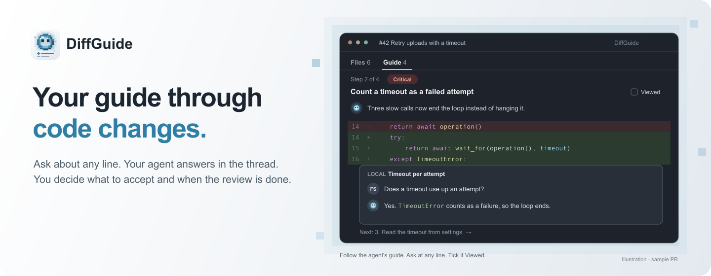
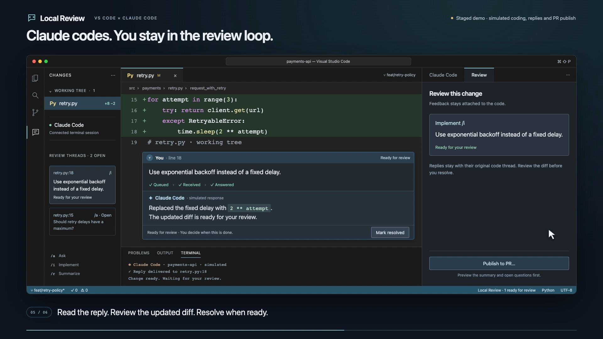
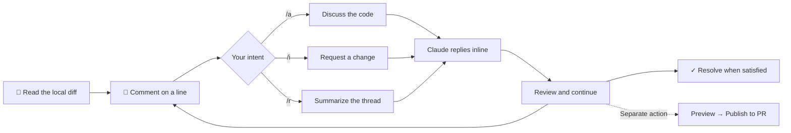
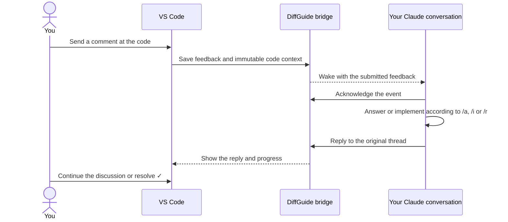

# DiffGuide

<p align="center">
  
</p>

<p align="center">
  
  
  
  
</p>

**Your guide through code changes.**

DiffGuide brings human-led code review and AI assistance together. Ask questions on the code, discuss potential problems, challenge implementation decisions and send feedback to your coding agent without losing the context of your review.

You stay in control. Claude helps you understand and improve the changes; you decide when the review is done.

<p align="center">
  <a href="https://github.com/kaiketsu-labs/diffguide/releases">Download</a> ·
  <a href="https://github.com/kaiketsu-labs/diffguide/blob/main/docs/INSTALL.md">Installation guide</a> ·
  <a href="https://github.com/kaiketsu-labs/diffguide/blob/main/docs/USAGE.md">Full guide</a> ·
  <a href="https://github.com/kaiketsu-labs/diffguide/issues">Issues</a>
</p>

---

## Why

Reviewing an agent's changes often means copying code into a terminal, explaining which lines you mean, and finding the answer again later. A GitHub draft review keeps the context together, but takes you out of the local editing loop.

DiffGuide brings that conversation into the editor: **feedback attached to a line, delivered to Claude, with the answer returned to the same thread.** Keep reading the diff while the agent works. Resolve the thread when you are satisfied.

<p align="center">
  <a href="https://github.com/kaiketsu-labs/diffguide/blob/main/docs/media/diffguide-demo.mp4"></a>
  <br><sub>Staged demo with simulated responses and the optional side composer. The default input uses native inline comments.</sub>
</p>

## Features

| | |
| --- | --- |
| 💬 **Review at the line** | Native inline comments in local files and diffs, with captured code context attached to each submitted comment. |
| ⚡ **Automatic delivery** | Send feedback once; your connected Claude conversation receives it without a separate review submission. |
| 🎛️ **Ask, implement, summarize** | Use `/a` to discuss, `/i` to request a change, and `/r` to summarize the thread. |
| 🎨 **Readable code** | Padded code cards, syntax colors and a small editor icon for opening the source with native navigation. |
| 📌 **Keep your draft** | An optional compact side composer follows new selections while empty and keeps written feedback attached to its original code. |
| ✅ **You resolve it** | Claude reports progress and replies. You decide when a thread is done; completed threads can be reopened. |
| 🔁 **Choose your conversation** | Search saved conversations by name or branch, start a new one, or connect the conversation already running in your terminal. |
| 🧭 **Guided PR review** | Claude groups a PR's changes by severity, orders them for reading and explains each step. Every change lands in one step, so ticking Viewed on each step covers the whole PR. |
| 📋 **Pull Requests sidebar** | Lists your PRs and your review requests, including those sent to your teams, per repository, with a collapsed **All open** group for every open PR. Click a PR to open its review page. Your PRs waiting on reviewers show a yellow eye and **Awaiting review**; review requests say **Direct** or **via** the team. **Show only my PRs awaiting review** in the view's … menu filters Mine. **Copy Link** on a PR's context menu copies its GitHub link. **DiffGuide: Open PR in DiffGuide** opens the review page from a pasted PR link or `owner/repo#57`, in the workspace folder that holds that repository. |
| 🐙 **The whole GitHub PR** | The review page covers GitHub's PR tabs: conversation with comments, reviews, reactions, edits and events; commits with per-commit diffs and changes since your last review; a file tree, file filters and hidden whitespace; check annotations and re-runs; and a merge box with branch protection, update branch, auto-merge, merge queue and revert. |
| 🧩 **Linked changes** | A PR that needs changes in other repositories shows them in **Linked changes**: each linked PR's state, or the branch Claude made where there is none yet, with **Push** and **Push and open draft PR**. PRs link through GitHub mentions, dependency pins to a branch in the diff, Claude's edits or **Link a PR…**; **Unlink** hides one. Claude reads other repositories freely; its file edits there are limited to DiffGuide worktrees, one Claude run at a time per worktree. |
| 🔗 **Carry it into a PR** | Preview summaries and unresolved questions, edit the text, then explicitly publish to the branch's existing GitHub PR. |
| 🎙️ **Speak your feedback** | Use existing macOS Dictation in the comment field, without an extra recorder or transcription account. |

## The review loop



| Write | Result |
| --- | --- |
| `/a Why use a fixed delay here?` | Claude explains the decision in the thread. |
| `/i Add a timeout for each attempt.` | Claude implements the requested change and returns it for review. |
| `/r` | Claude summarizes the existing conversation and remaining decisions. |

`/a` and `/r` request discussion without edits; they are not a separate permission sandbox. Claude's existing tool permissions still apply. `/r` never publishes anything to GitHub.

## Install

**Install the VS Code extension**

Download a `.vsix` from [GitHub Releases](https://github.com/kaiketsu-labs/diffguide/releases), then use **Extensions → … → Install from VSIX…**. The extension is not on the Marketplace yet.

Or install a downloaded package from your terminal:

```bash
code --install-extension ./diffguide-<version>.vsix --force
```

**Connect Claude**

Open a trusted local Git repository and run **DiffGuide: Mit Claude verbinden**.

| Choose | What happens |
| --- | --- |
| **Unterhaltung auswählen** | Search this project's recent conversations by name or branch. Running conversations are marked **Läuft**. |
| **Neue Unterhaltung** | Start a fresh Claude conversation with review feedback enabled. |
| **Laufende Unterhaltung verbinden** | Keep your original Claude process and conversation. Copy the two commands shown in VS Code into that conversation. |

To connect a running conversation, execute `/reload-plugins --force`, then `/diffguide:connect` inside it. This requires **Claude Code 2.1.280+** and installs a project-local plugin; reloading rereads the conversation context once. Wait for **Feedback aktiv** before sending a comment.

For a separate terminal app, the same running-conversation commands apply. To start or resume there instead, use **Review → … → Verbindungsbefehl kopieren** at its shell prompt. Keep the project's VS Code window open. [Connection details →](https://github.com/kaiketsu-labs/diffguide/blob/main/docs/CLAUDE-SESSION-ATTACH.md)

**Leave your first comment**

Open **DiffGuide: Änderungen reviewen**, click the gutter **+**, or select code and press **⌘⌥M** on macOS / **Ctrl+Alt+M** on Linux. Write `/a` or `/i` followed by your feedback and choose **Senden**. Continue in the thread's reply field.

Requires **VS Code 1.100+**, **Node.js 20+**, **Git**, and authenticated **Claude Code with `asyncRewake` support**. macOS is the verified primary platform; Linux is unverified, and automatic Windows connection is not supported yet. [Setup and troubleshooting →](https://github.com/kaiketsu-labs/diffguide/blob/main/docs/INSTALL.md)

## Moving from Pair Review

DiffGuide is a new extension with the ID `kaiketsu-labs.diffguide`, so VS Code does not update Pair Review to it.

- Uninstall Pair Review, then install DiffGuide.
- Settings moved from `pairReview.*` to `diffGuide.*`, and commands from `pairReview.*` to `diffGuide.*`. Rename your settings, keybindings and theme color overrides (`pairReview.selectionBackground`, `pairReview.selectionBorder`) by hand.
- Side-composer drafts, comment window contrast, pinned and hidden PRs, and seen Claude answers start fresh.
- Local review threads in plain workspaces start empty.
- PR worktrees under `.claude/worktrees/pair-review/` move to `.claude/worktrees/diffguide/`, with their threads, the first time you open each PR.
- DiffGuide updates the handoff comments Pair Review posted on GitHub instead of adding new ones.
- In Claude, run `/diffguide:connect`. Setup removes the old Pair Review plugin.

## How it works



A small local helper waits for saved feedback; the LLM does not repeatedly check for comments. Claude answers through review tools, which return the reply to VS Code. A connection or notification alone does not acknowledge delivery.

Threads and private connection files live in VS Code's workspace storage. The launched-session flow passes settings to Claude without replacing your existing project configuration. Running-conversation setup uses Claude's plugin manager with local scope and preserves existing settings. Only the explicitly selected conversation can receive feedback through that plugin. [Architecture and walkthrough →](https://github.com/kaiketsu-labs/diffguide/blob/main/docs/HOW-IT-WORKS.md)

## Make it yours

| Action / setting | Effect |
| --- | --- |
| **Kommentarfenster hervorheben** | Apply a distinct thread surface, reply fill and neutral border in this project. The paired reset action restores prior colors. VS Code shares these tokens with other comments and Peek views. |
| **Zentrierte Ansicht** | Narrow the source editor and its inline conversations together. VS Code controls native comment width. |
| **Feedback in Seitenansicht schreiben** | Open the optional compact composer with mode buttons, saved drafts and selection following. |
| `diffGuide.claudePath` | Choose your Claude executable when multiple installations exist. |
| `diffGuide.nodePath` | Choose the Node.js 20+ executable used by the integration. |
| `diffGuide.transport` | `hooks` is the default. `channels` is an experimental alternative with additional prerequisites. |

The interface currently uses German labels. Code previews provide display colors; use the editor icon for hover, references and language-server navigation. [Full usage guide →](https://github.com/kaiketsu-labs/diffguide/blob/main/docs/USAGE.md)

## Roadmap and verification

- [x] Native inline questions, change requests and thread summaries
- [x] Automatic feedback delivery and replies to the original thread
- [x] Specific saved conversation or new conversation
- [x] Human resolution, hidden completed threads and reopening
- [x] Editable preview before publishing to an existing PR
- [x] Connect to an already-running conversation without restarting it
- [x] Unread reply navigation and direct Claude-to-thread navigation
- [ ] VS Code Marketplace / Open VSX publication
- [ ] Linux and Windows verification

Planned, not built yet: reviewing changes from any source, and a companion character.

Guide notes are stored as threads that start with Claude's message. Versions before guided review cannot load a PR's comments once it has a guide.

The [running-conversation verification](https://github.com/kaiketsu-labs/diffguide/blob/main/docs/QA-2026-10-26.md) records an authenticated Claude session started before setup, unchanged process/session identity after connecting, and a real inline question and formatted reply. Strict TypeScript and **256 tests** pass. Busy-agent delivery, a full separate-terminal roundtrip and real remote PR publication remain separate verification tasks. [Earlier native review](https://github.com/kaiketsu-labs/diffguide/blob/main/docs/UX-REVIEW-2026-10-21.md) · [Review tracker](https://github.com/kaiketsu-labs/diffguide/blob/main/docs/REVIEW.md)

## Development

```text
diffguide/
├── src/             VS Code UI, durable review store, bridge and Claude integration
├── test/            Controller, rendering and real-process transport tests
├── resources/       Extension icon and review avatars
└── docs/            Setup, architecture, demos, publishing and QA evidence
```

```bash
git clone https://github.com/kaiketsu-labs/diffguide.git
cd diffguide
npm ci --ignore-scripts
npm run typecheck
npm test
npm run package
```

The generated `.vsix` can be installed through VS Code. `make install` packages it and installs it in one step; `make` lists the other targets. [Contributing](https://github.com/kaiketsu-labs/diffguide/blob/main/CONTRIBUTING.md) · [Publishing guide](https://github.com/kaiketsu-labs/diffguide/blob/main/docs/PUBLISHING.md)

Built on the [VS Code Comments API](https://code.visualstudio.com/api/references/vscode-api#CommentController), [Claude hooks](https://code.claude.com/docs/en/hooks), and [MCP](https://code.claude.com/docs/en/mcp). Not affiliated with Anthropic or Microsoft.

The [PR management reliability review](https://github.com/kaiketsu-labs/diffguide/blob/main/docs/QA-PR-MANAGEMENT-2026-11-03.md) records partial-write recovery fixes, 364 passing automated tests, and the still-pending real GitHub and native VS Code verification.
