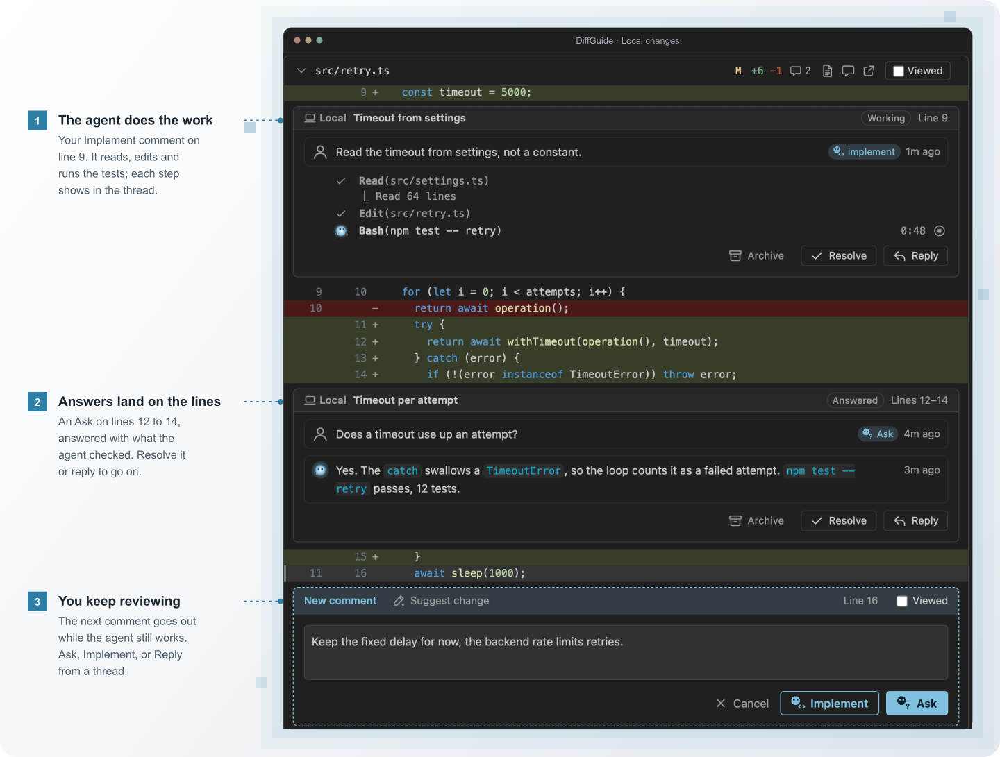

# DiffGuide

<p align="center">
  
</p>

<p align="center">
  
  
  
</p>

DiffGuide is a review page in VS Code for your local changes and your GitHub pull requests. Comment on a line, and your coding agent answers in the same thread or changes the code. You decide what to accept and when the review is done.

<p align="center">
  <a href="https://marketplace.visualstudio.com/items?itemName=kaiketsu-labs.diffguide">Install</a> ·
  <a href="https://github.com/kaiketsu-labs/diffguide/blob/main/docs/USAGE.md">Guide</a> ·
  <a href="https://github.com/kaiketsu-labs/diffguide/blob/main/docs/INSTALL.md">Setup and troubleshooting</a> ·
  <a href="https://github.com/kaiketsu-labs/diffguide/issues">Issues</a>
</p>

## Three ways to review

<table>
  <tr>
    <td></td>
    <td><b>Comment at the line.</b> Click a line and choose <b>Ask</b> to discuss it, <b>Implement</b> to change it, or <b>Reply</b> to draft your GitHub answer. The agent reads the codebase, runs the tests and edits the code for exactly those lines, while you write the next comment.</td>
  </tr>
  <tr>
    <td></td>
    <td><b>Guide.</b> <b>Build guide</b> has the agent order a PR's changes into steps by severity and explain each one. Tick <b>Viewed</b> on every step and you have covered the whole PR.</td>
  </tr>
  <tr>
    <td></td>
    <td><b>Code review.</b> <b>Review</b> sends correctness, design, security, performance and test agents over the change. Each proves its findings in its own worktree, with a failing test, a trace or a citation, before they open as threads.</td>
  </tr>
</table>

## Around the review

<table>
  <tr>
    <td></td>
    <td><b>The whole GitHub PR.</b> Conversation, commits since your last review, checks and the merge box on one page.</td>
  </tr>
  <tr>
    <td></td>
    <td><b>Pull Requests sidebar.</b> Your PRs and review requests per repository, colored by unpushed commits and uncommitted edits. The orb marks rows where the agent is working.</td>
  </tr>
  <tr>
    <td></td>
    <td><b>Linked changes.</b> A PR that needs changes in other repositories lists them, with the branch the agent made and <b>Push and open draft PR</b>.</td>
  </tr>
</table>

## How it works

<p align="center">
  
</p>

A small local helper waits for your comment and wakes the agent conversation you connected. The agent does not poll for comments. It answers through review tools that put the reply back in the thread. Threads stay in VS Code's workspace storage. [Architecture →](https://github.com/kaiketsu-labs/diffguide/blob/main/docs/HOW-IT-WORKS.md)

## Install

Install **DiffGuide** from the [VS Code Marketplace](https://marketplace.visualstudio.com/items?itemName=kaiketsu-labs.diffguide), or run:

```bash
code --install-extension kaiketsu-labs.diffguide
```

Each [GitHub release](https://github.com/kaiketsu-labs/diffguide/releases) also carries a `.vsix`.

Then open a trusted local Git repository, click **Review local changes** in the DiffGuide **Local** view, and **Connect Claude** on the review page. Start a new conversation, resume a saved one, or connect the one already running in your terminal.

Requires VS Code 1.100+, Node.js 20+, Git and an agent. Claude Code is the supported agent today. macOS is verified; Linux is unverified; automatic connection does not work on Windows yet. [Setup and troubleshooting →](https://github.com/kaiketsu-labs/diffguide/blob/main/docs/INSTALL.md)

Coming from Pair Review? [Move your settings →](https://github.com/kaiketsu-labs/diffguide/blob/main/docs/INSTALL.md#moving-from-pair-review)

## Development

```bash
git clone https://github.com/kaiketsu-labs/diffguide.git
cd diffguide
npm ci --ignore-scripts
npm run typecheck
npm test
make install    # package and install into VS Code
```

[Contributing](https://github.com/kaiketsu-labs/diffguide/blob/main/CONTRIBUTING.md) · [Publishing](https://github.com/kaiketsu-labs/diffguide/blob/main/docs/PUBLISHING.md) · [Review tracker](https://github.com/kaiketsu-labs/diffguide/blob/main/docs/REVIEW.md)

Built on [VS Code webviews](https://code.visualstudio.com/api/extension-guides/webview), [Claude hooks](https://code.claude.com/docs/en/hooks) and [MCP](https://code.claude.com/docs/en/mcp). Not affiliated with Anthropic or Microsoft.
