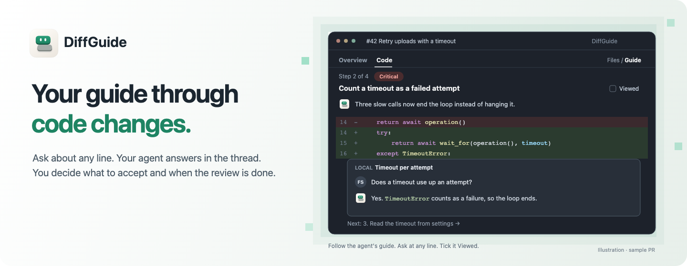
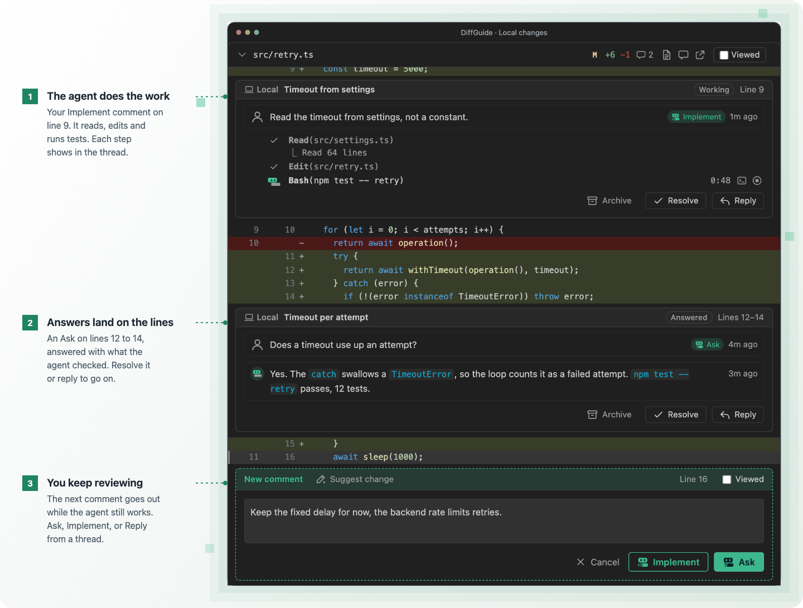

# DiffGuide

<p align="center">
  
</p>

<p align="center">
  
  
  
</p>

<p align="center">
  Review local changes and GitHub pull requests with Claude Code in VS Code. Select lines on the review page, then choose <b>Ask</b> to discuss the code or <b>Implement</b> to request a change. DiffGuide sends your comment to Claude automatically. The answer comes back in the same thread, and you decide when to resolve it.
</p>

<p align="center">
  <a href="https://marketplace.visualstudio.com/items?itemName=kaiketsu-labs.diffguide">Install</a> · <a href="docs/USAGE.md">Usage guide</a> · <a href="docs/INSTALL.md">Setup and troubleshooting</a> · <a href="https://github.com/kaiketsu-labs/diffguide/issues">Report an issue</a>
</p>

## Get started

Install DiffGuide from the VS Code Marketplace, or run the following command.

```bash
code --install-extension kaiketsu-labs.diffguide
```

[GitHub releases](https://github.com/kaiketsu-labs/diffguide/releases) also provide a VSIX.

1. Open a trusted Git repository in VS Code.
2. In DiffGuide's **Local** view, choose **Review local changes** on a checkout.
3. Choose **Connect Claude** to start, resume, or connect a running Claude conversation.
4. Select lines, write a comment, and send it with **Ask** or **Implement**.

Requires VS Code 1.100+, Node.js 20+, Git, and authenticated Claude Code with `asyncRewake` support. PR sync requires Git 2.40+. See [platform support and connection requirements](docs/INSTALL.md).

## Three ways to review

<table>
  <tr>
    <td></td>
    <td><b>Comment on the code.</b> Choose <b>Ask</b> to discuss selected lines or <b>Implement</b> to request a change. Claude replies in the same thread.</td>
  </tr>
  <tr>
    <td></td>
    <td><b>Build guide.</b> Claude groups PR changes by severity and explains each step. Mark steps <b>Viewed</b> as you go.</td>
  </tr>
  <tr>
    <td></td>
    <td><b>Review</b> in Claude's menu checks local changes or a PR for bugs, design issues, security issues, performance issues, and gaps in tests. Findings with evidence open as review threads.</td>
  </tr>
</table>

## Around the pull request

<table>
  <tr>
    <td></td>
    <td><b>Review on one page.</b> Overview shows the conversation, checks, and merge controls. Code shows the diff in Files or Guide order. Use <b>Finish review</b> to submit pending GitHub comments and your verdict. Local threads can be previewed and published separately.</td>
  </tr>
  <tr>
    <td></td>
    <td><b>Pull Requests sidebar.</b> Open your PRs and review requests by repository. The Diff pair marks rows where Claude is working.</td>
  </tr>
  <tr>
    <td></td>
    <td><b>Linked changes.</b> See related PRs and branches Claude created in other repositories. Push a branch or open a draft PR from the page.</td>
  </tr>
</table>

## How it works

<p align="center">
  
</p>

A small local helper waits for a submitted comment and wakes the Claude conversation you connected. Claude reports progress and replies in the same thread. You can keep reviewing or send another comment while Claude works. DiffGuide saves the threads in VS Code's workspace storage. [How the connection works](docs/HOW-IT-WORKS.md)

## Development

```bash
npm ci --ignore-scripts
npm run typecheck
npm test
```

[Contributing](CONTRIBUTING.md) · [Publishing](docs/PUBLISHING.md)
