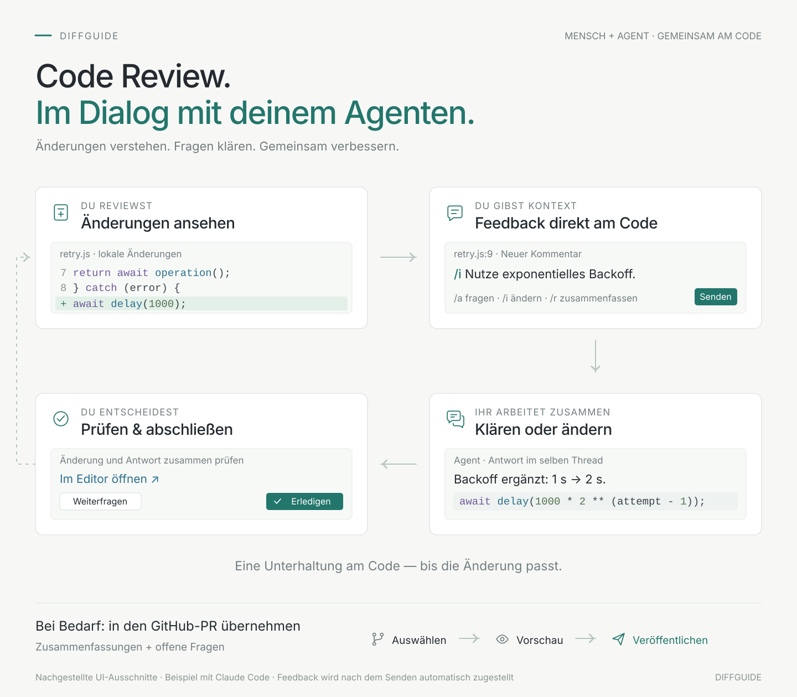

# Review code together with your agent

**Inspect changes, settle questions and improve the code together, right in VS Code.** Your agent receives sent feedback automatically and answers in the same comment thread.

The images are staged examples of the UI, not a recording of a verified live session.

## Connect once

Open your project in VS Code and run **DiffGuide: Connect Claude**. Start a new Claude Code conversation or resume an earlier one. The connected conversation runs in the integrated terminal. A Claude session you started separately does not connect automatically. [Installation and connection](INSTALL.md)

## Comment on the code

Open the **Local** view in the sidebar and click **Review local changes** on a checkout row. The review page shows your uncommitted changes and new files. Click a line number, write for example "Use exponential backoff.", and choose **Implement**. Claude receives your comment with its file, lines and code context. An unsent draft stays a draft.

| Button | What you want |
| --- | --- |
| **Ask** | Ask a question or discuss the code. |
| **Implement** | Have a specific change made. |

## Check the answer

The status shows whether your request is waiting, received, in progress or ready to check. Claude's answer appears in the original thread on the review page. Multi-line code gets its own highlighted code block. **Open in editor** opens the file in the editor.

You can ask a follow-up, request another change or finish the thread. **An answer from Claude does not finish the thread by itself.**

**Resolve** finishes a thread, and **Reopen** makes it active again. The history stays saved.

## Does Claude keep checking for comments?

**The language model does not.** A small helper on your machine waits in the background for sent feedback. As soon as a comment arrives, it passes the content to Claude. No model requests run while it waits. If a tool is running, it finishes first.

Technical details and sources

The default path combines Claude Code hooks with MCP tools. The model runs no repeated query; a local helper process uses **long polling**.

DiffGuide first saves each request with an immutable event ID, file, lines and code context in VS Code's local workspace storage. Only after a successful save does it notify waiting components. [Storage](../src/core/store.ts) · [Context passed on](../src/agents/claude/eventPrompt.ts)

The hook helper reads pending requests with `GET /pending` and then keeps a local request open with `GET /events?after=<sequence>`. A newly saved event answers that request at once. With no work, an empty request times out after at most 20 seconds; the helper checks the current state and waits again. **The 20 seconds are not a delivery interval.** The helper hands the request to Claude Code through an `asyncRewake` hook. Claude receives it at a safe processing point; running tool calls are not interrupted. [Hook helper](../src/agents/claude/hookWaiter.ts) · [Long polling](../src/agents/claude/bridge.ts)

A local delivery history per Claude session keeps each new `Stop` or tool hook from announcing the same unconfirmed comment again. The message starts with the file, mode and a short feedback excerpt; shared instructions appear once per batch. This does not change the confirmation in the review store. `SessionStart` skips the history on purpose and offers the newest open request of each open thread again, also when resuming the same conversation. Earlier requests stay in the history, but after a follow-up comment they are not delivered as new work.

Claude confirms with `acknowledge_review`, reports that work started with `set_review_working` and answers with `reply_to_review`. "Connected" alone confirms no single request. The MCP helper also checks the local connection every 15 seconds. That check is not a model call either. [MCP tools and connection check](../src/agents/claude/channel.ts)

The hook configuration starts the waiting helper on `SessionStart`, `UserPromptSubmit`, `PostToolUse` and `Stop`. A lock allows one active helper per workspace. A helper ends after at most 24 hours; reconnecting or sending Claude a prompt starts the waiting path again. Requests already sent stay saved. After interruptions, a delivery can repeat. Event IDs help match requests but do not guarantee code changes happen exactly once. [Start and configuration](../src/hosts/vscode/setup.ts) · [Restart and lock](../src/agents/claude/hookWaiter.ts)

The local handoff uses an authenticated connection on `127.0.0.1`. Claude keeps using its configured provider for the model itself. Generated integration files live in workspace storage, outside the project repository. No project files such as `.claude/settings.json` or `.mcp.json` are rewritten. [Connection check](../src/core/connection.ts) · [Local server](../src/agents/claude/bridge.ts) · [Integration files](../src/hosts/vscode/setup.ts)

**Why hooks are the default:** they fit the current terminal and gateway workflow. The alternative Channels mode forwards notifications to Claude through MCP and must be chosen explicitly. It is a research preview with special sign-in and organization requirements. According to the Claude documentation, Bedrock, Vertex AI and Microsoft Foundry are not supported for it, so compatibility with an arbitrary gateway is not guaranteed. Channels stays an optional alternative. [Claude Code documentation on Channels](https://code.claude.com/docs/en/channels) · [Transport choice](../src/hosts/vscode/setup.ts) · [Channel notifications](../src/agents/claude/channel.ts)

About the diagram and test status

The [SVG diagram](media/diffguide-flow.svg) shows the shared review cycle with staged comments and real JavaScript snippets. Neutral light surfaces, clear type and quiet accents keep the focus on the code and the review decisions. The diagram has no external dependencies.

The [PNG version](media/diffguide-flow.png) rendered from it is used in the README and the package, because VS Code's package check rejects SVG images in the README.

As of version 0.4.4. The diagram explains the implemented UI and is not proof of a fully verified live session. [REVIEW.md](REVIEW.md) records the current test status.

