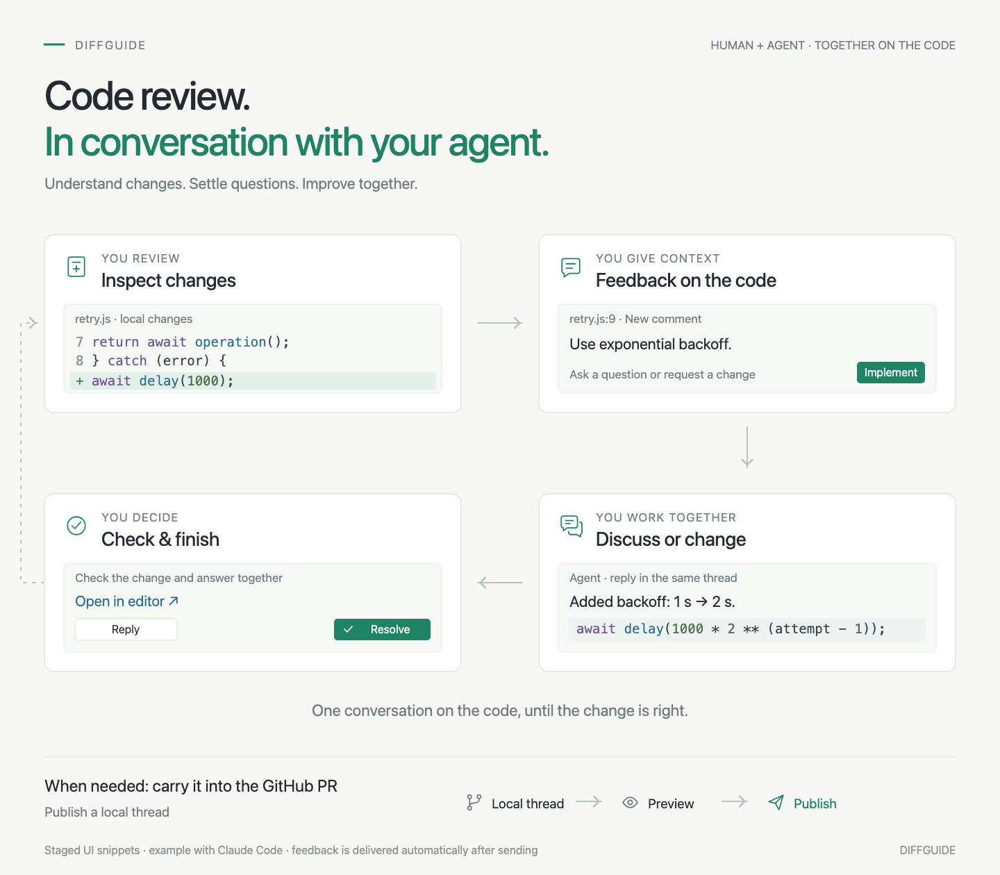

# DiffGuide

Review local changes and GitHub pull requests in VS Code. Select lines on the review page to ask Claude a question or request a change. Replies return to the same thread.

[Install the preview](INSTALL.md) · [Download a VSIX](https://github.com/kaiketsu-labs/diffguide/releases) · [Report an issue](https://github.com/kaiketsu-labs/diffguide/issues/new/choose)

## A review that becomes a conversation

Open the review page, leave feedback, and keep reviewing. Each submitted comment reaches your connected agent automatically; there is no separate review submission.

| Action | What Claude is asked to do |
| --- | --- |
| **Ask** | Explain a decision or discuss the code. |
| **Implement** | Make the requested change, then return it for your review. |

The **Local** view in the DiffGuide sidebar lists each checkout with how many files changed and how many comments are open. Clicking a checkout opens its review page. **Files** lists uncommitted changes and new files against HEAD, each with its icon from your file icon theme. **All files** in the **View** menu adds every other repository file to the list, dimmed; it is on by default on local pages and off on PR pages. Click an unchanged file to show it whole, marked **Not changed**. **Show in DiffGuide** in the Explorer's context menu does the same. Files you opened and files with open threads sit in an **Opened** group at the top of the list. × on the row or the file's header closes one while it has no comments; **Close all** closes every such file.

A workspace folder outside Git also gets a row in the **Local** view. Its page has no diff: it shows the folder's files whole (the first 200, without `node_modules`), and **Show in DiffGuide** adds others. Comments, **Ask** and **Implement** work as in a repository; Claude's code review needs a diff, so it is not offered there.

With several checkouts, such as the window's folders, nested repositories and their Git worktrees, the view lists each checkout under its repository's row. The filter button in the view's title bar narrows them by repository, branch, or PR number or title. Each checkout row's **Review local changes** button opens that checkout's own page, with its own comments, Viewed marks and Claude connection. Rows of PR worktrees open the PR's review page instead; their files open there, whole when the PR does not change them.

When a checkout's branch has an open PR of yours, its page shows a **PR #N** chip beside the branch. The chip turns the tab into the PR's review page on that same checkout. Threads, Viewed marks and the connected Claude conversation carry over. [How DiffGuide syncs your checkout](SYNC.md)

Click a line number, or drag across several, to comment. Or select code in the diff and click the **+** below the selection: the comment covers the selected lines, and the selected text stays marked. Claude gets that text with your comment. The thread's header shows which characters it marks, and hovering the thread highlights them. Esc clears a selection. GitHub comments cover whole lines. The Threads card lists every thread with its file, line and status. Claude can reply and report progress; **you decide when a thread is resolved**. **Resolve** closes it and **Reopen** continues it. Nothing is deleted.

**Viewed** on a file or on selected lines works as on PR pages. Marks lapse once the code changes. The page reads the files again when they change on disk.

**Speak on macOS:** click the comment field, then use your Mac's Microphone key or Dictation shortcut. Review the text and choose **Ask** or **Implement**. [Dictation guide →](DICTATION.md)

Claude's code appears in syntax-colored blocks. Cmd/Ctrl-click a name in the diff to peek at its definition, and **Open in editor** opens the file for hover, references and editing. Suggested changes in a reply offer **Apply**, which writes them to the file without committing.

## Start in a minute

Install **DiffGuide** from the [VS Code Marketplace](https://marketplace.visualstudio.com/items?itemName=kaiketsu-labs.diffguide). Each [GitHub release](https://github.com/kaiketsu-labs/diffguide/releases) also carries a `.vsix`.

Open a trusted local Git repository and click **Connect Claude** on the local review page:

| Choice | Result |
| --- | --- |
| **New conversation** | Start a fresh conversation with review feedback enabled. |
| **Resume a conversation…** | Search this project's recent conversation names and branches; running conversations are marked. **All conversations in Claude…** opens Claude's own picker. |
| **Connect running Claude** | Keep the original Claude process and conversation; run the menu's two copyable commands inside it. Requires Claude Code 2.1.280+. |
| **Copy command** | Copy a start command for a terminal outside VS Code. |

The Command Palette's **DiffGuide: Connect Claude** offers the same choices when no review page is open.

To connect a running conversation, prepare it in VS Code, then run `/reload-plugins --force` and `/diffguide:connect` in the intended Claude conversation. DiffGuide installs a project-local plugin and waits for that session's actual receiver before showing **Feedback on**. The reload rereads conversation context once. You can run the commands in VS Code or a separate local terminal. For a new/resumed conversation in a separate app, use **DiffGuide: Copy connect command** at a shell prompt. Keep the project's VS Code window open. [Connection details](CLAUDE-SESSION-ATTACH.md).

Click **Review local changes** on a checkout in the **Local** view, then click a line number. Write your feedback and choose **Ask** or **Implement**. Continue with the thread's **Reply**.

Requires **VS Code 1.100+**, **Node.js 20+**, **Git**, and an installed, authenticated **Claude Code with `asyncRewake` support**. macOS is the primary target; Linux is unverified. Automatic connection is currently unavailable on Windows. [Installation and troubleshooting →](INSTALL.md)

## How the connection works

Send a comment and your connected Claude session receives it automatically. Claude's answer returns to the same conversation. The LLM does not repeatedly check for comments; a small local helper waits for saved feedback. An already running tool can finish before Claude handles the new request. [How feedback reaches Claude](HOW-IT-WORKS.md)

Hook messages identify the file, review mode and actual feedback. Ordinary tool calls and Stop hooks do not repeatedly announce the same event in one session. Starting or resuming Claude explicitly recovers unfinished work; delivery is still acknowledged only through Claude's review tools.

After upgrading, reconnect Claude once. A window reload reuses this project's managed **Claude · DiffGuide** terminal instead of creating a second session.

Connection files and submitted threads live in VS Code's workspace storage. The extension passes configuration to the session it launches, without editing your repository's `.claude` files or `.mcp.json`. Claude's existing tool permissions still apply; **Ask** is an instruction to avoid edits, not a separate permission sandbox.

A comment captures its code when you send it. Replies keep the thread's original context. A thread whose code is gone shows above its file's diff as a comment on lines the diff does not show.

## Code review

**Review** in Claude's chip menu has Claude review the changes with review agents, on a PR's page and on a local page. The arrow beside it picks the agents; DiffGuide remembers the choice per repository. Under **Focus** in the same menu, tell the review what to look at first, such as "the retry loop"; the agents still report anything else they can prove.

| Agent | Reports | Evidence it needs |
|---|---|---|
| Correctness | Wrong behavior and regressions in code the change did not touch | An input that fails, best a failing test |
| Design | Code that duplicates a helper, sits in the wrong layer or breaks the codebase's patterns | Existing code or a rule in the repository's `CLAUDE.md`, `AGENTS.md`, `CONTRIBUTING.md` or lint config |
| Security | Untrusted input reaching paths, commands, queries or HTML; mishandled secrets | A trace from input to harm |
| Performance | Cost that grows with input on a path users wait on | A measurement or a complexity argument at a real size |
| Tests | Changes no test would catch | The missing case and what would fail |
| Docs | Docs, help text, examples or doc comments the change made wrong | The doc text quoted beside the code it contradicts, or the documented example run |

Claude briefs the agents, skips one the change gives nothing to check, collects their candidates, keeps the 10 strongest at most and sends them back to be proven. An agent with no candidates is not called again. Each agent proves its candidates in its own worktree under `.claude/worktrees/diffguide/review/`, a copy of the checkout with your uncommitted changes, where it may install dependencies, write tests and run them. DiffGuide removes these worktrees when the review ends. On someone else's PR this runs the PR's code on your machine.

Proven findings open as **Review** threads with the agents that raised them, the severity and how they were proven: **Tested**, **Traced** or **Cited**. The summary card above the files lists them, which agents ran, and under **Dropped** every candidate that was not posted, with its reason. A new review replaces findings nobody replied to or resolved. **Clear** removes the review card and archives those findings. Use **Show archived** to see them again.

## Your own instructions for Claude

Add Markdown files to steer Claude: `guide.md` for **Build guide** on the review page, `comments.md` for Claude's work on your review comments, both answers and changes. Claude gets them after the built-in instructions, which still decide the output format and tools. DiffGuide reads them on every run, from the most general to the most specific; on conflict the later file wins:

| File | Applies to |
| --- | --- |
| `~/.claude/diffguide/` | every project |
| `.claude/diffguide/` in each parent folder of the project, outermost first, below your home folder | projects in that folder |
| `.claude/diffguide/` in the repository | everyone working on the repository |
| `~/.claude/projects/<project>/diffguide/` | you, in this project |

`~/.claude` is `CLAUDE_CONFIG_DIR` when set. `<project>` is the project path with every character other than a letter or digit replaced by `-`, the same folder Claude Code keeps the project's conversations in. On someone else's PR, the repository's file comes from the base branch, so a PR cannot change the instructions it is reviewed with. For the same reason, Claude skips that checkout's `CLAUDE.md`, skills, hooks, settings and MCP servers.

## PR worktrees

Each PR you open gets its own checkout under `.claude/worktrees/diffguide/` in the repository, where Claude Code keeps its own worktrees. Claude can edit there, and your Claude account choice and parent `CLAUDE.md` files apply as in the repository itself. DiffGuide hides the folder from Git through `.git/info/exclude`, so nothing changes in `.gitignore`.

DiffGuide removes a PR's worktree when the PR is merged or closed, or when you have not opened it for `diffGuide.worktreeCleanupDays` days (14 by default, 0 turns the age limit off). It never removes a worktree with uncommitted changes or unpushed commits. It checks when VS Code starts, and **DiffGuide: Clean up worktrees** checks right away.

## A PR's Claude conversation

Each PR keeps one Claude conversation, and every comment's run continues it, so it grows. The token count beside Claude's status shows how large it was after the last run. Every run re-reads all of it, and the bar turns yellow at half of the model's context window. Click it for:

- **New conversation**: the next comment starts a fresh conversation. Claude forgets earlier runs, but each comment still sends its own thread.
- **Compact**: runs Claude Code's `/compact` in the conversation, which summarizes it and keeps going.

On the local page and on a PR page using your own checkout, Claude's menu can show how full a connected conversation is. Open its terminal to start fresh or compact it.

## Drafting a reply for GitHub

**Draft reply** sits in a thread's Reply form and has Claude write the comment you would post on GitHub. It reads the form's text first: leave it empty, type notes on what to say ("suggest `shouldRetry`, keep it short"), or edit an earlier draft and add what to change.

- On a GitHub thread, Claude writes your next reply in the thread and it replaces the form's text.
- On a Local thread, Claude writes one self-contained comment for the PR's other reviewers and its author, with the conclusion and without your questions. It opens the Publish form, where you edit it, choose **Draft reply** again to revise it from the form's text, or post it.

Drafting never posts, resolves or adds a message to the thread. Your notes stay on the page.

## Pull Requests sidebar

Lists your PRs and your review requests, including those sent to your teams, per repository, with a collapsed **All open** group for every open PR and their count. Click a PR to open its review page. Your PRs waiting on reviewers show a yellow eye and **Awaiting review**; review requests say **Direct** or **via** the team. **Show only my PRs awaiting review** in the view's … menu filters Mine. **Copy Link** on a PR's context menu copies its GitHub link. **DiffGuide: Open PR in DiffGuide** opens the review page from a pasted PR link or `owner/repo#57`, in the workspace folder that holds that repository.

## The whole GitHub PR

The PR page has Overview and Code tabs. Overview starts with the description and guide summary. Merge holds the checks, and Details unfolds Assignees, Labels, Milestone and Development. Code holds the files in Files or Guide order. Finish review opens its form on either tab. Local review opens the code directly, without tabs or Finish review.

The review page covers GitHub's PR tabs: conversation with comments, reviews, reactions, edits and events; commits with per-commit diffs and changes since your last review; a file tree, file filters and hidden whitespace; check annotations and re-runs; and a merge box with branch protection, update branch, auto-merge, merge queue and revert.

The header's More menu holds Open on GitHub, Remove worktree, Open in terminal and Link a PR. Open in terminal stops the PR's background Claude run and continues its conversation in VS Code's terminal. A conversation you connected keeps its terminal and connection choices in Claude's menu. The unpushed chip beside the branch holds Show changes. When you can edit the PR, **Push** sits beside Claude's chip and shows Pushing… until GitHub has the commits. Viewed progress appears only in the header.

## Linked changes

A PR with a linked PR shows **Linked changes** on Overview. Its rows show each linked PR's state and any branches Claude made in other repositories, with **Push** and **Push and open draft PR**. PRs link through GitHub mentions, dependency pins to a branch in the diff, Claude's edits or **Link a PR…** in More; **Unlink** hides one. Claude reads other repositories freely; its file edits there are limited to DiffGuide worktrees, one Claude run at a time per worktree.

## Settings

| Setting | Effect |
| --- | --- |
| `diffGuide.claudePath` | Choose your Claude executable when multiple installations exist. |
| `diffGuide.nodePath` | Choose the Node.js 20+ executable used by the integration. |
| `diffGuide.transport` | `hooks` is the default. `channels` is an experimental alternative with additional prerequisites. |
| `diffGuide.fontSize` | Size in pixels of the review page's text, such as menus, threads and replies (12 by default). The diff keeps the editor's font size. |

## Limits

- The background helper stops after 24 hours of idle time. Reconnect or send Claude a prompt to start it again.
- Submitted comments persist. Unsent text stays on the review page until it closes.
- After an interruption, a sent comment can be delivered again. DiffGuide uses event IDs to match replies to requests.
- Claude receives up to 20 recent messages and 100,000 characters of quoted thread history, plus the current request. A large queue of open comments can exceed the connection's response limit.
- See [platform and connection requirements](INSTALL.md#requirements).

## Contribute

[Development guide](../CONTRIBUTING.md) · [Publishing guide](PUBLISHING.md)
