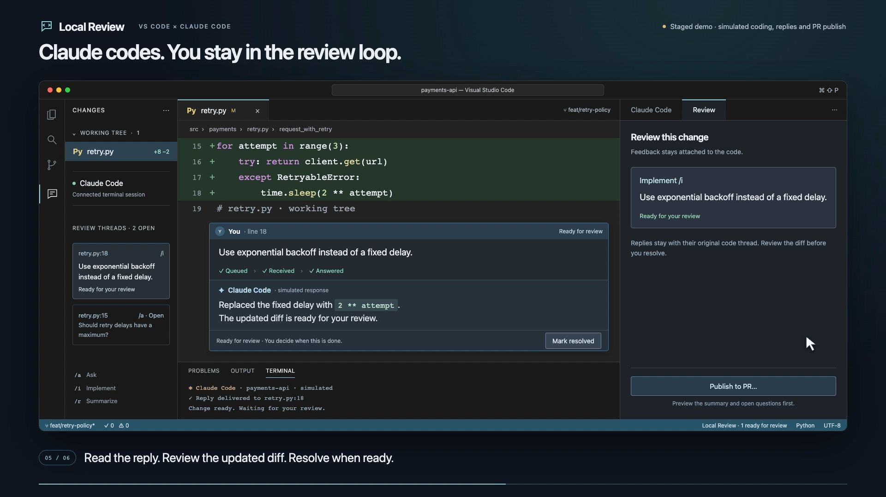
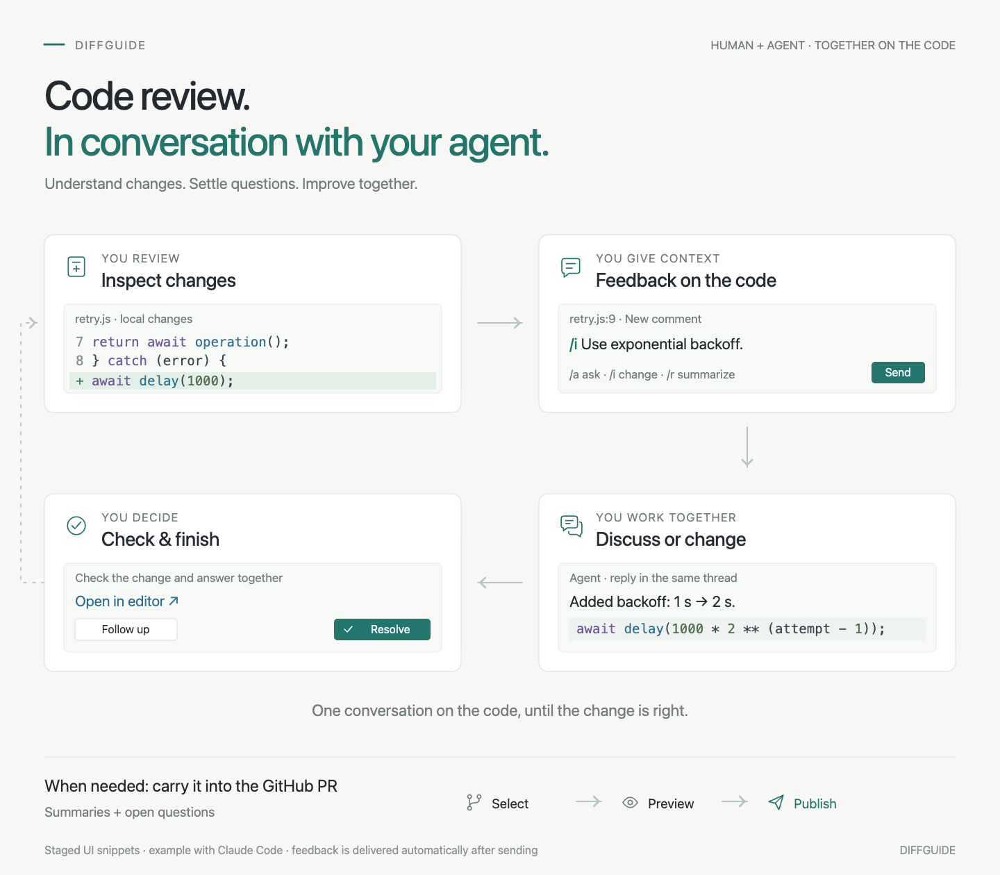

# DiffGuide

### Review local code. Give Claude feedback where it belongs.

GitHub-style review conversations, directly in VS Code. Pick a line in your local changes, ask a question or request a change, and send it straight to Claude Code in your terminal. Replies return to the same thread.

[Install the preview](INSTALL.md) · [Download a VSIX](https://github.com/kaiketsu-labs/diffguide/releases) · [Report an issue](https://github.com/kaiketsu-labs/diffguide/issues/new/choose)

**Demo:** staged interface of an earlier version with simulated Claude responses and native inline comments. Comments now live on the review page. It is not a recording of a verified live integration.

## A review that becomes a conversation

Open the review page, leave feedback, and keep reviewing. Each submitted comment reaches your connected agent automatically; there is no separate review submission.

| Action | What Claude is asked to do |
| --- | --- |
| **Ask** | Explain a decision or discuss the code. |
| **Implement** | Make the requested change, then return it for your review. |

The **Local** view in the DiffGuide sidebar lists each checkout with how many files changed and how many comments are open. Clicking a checkout opens its review page. **Files** lists uncommitted changes and new files against HEAD, each with its icon from your file icon theme. **All files** in the **View** menu adds every other repository file to the list, dimmed; it is on by default on local pages and off on PR pages. Click an unchanged file to show it whole, marked **Not changed**. **Show in DiffGuide** in the Explorer's context menu does the same. Files you opened and files with open threads sit in an **Opened** group at the top of the list. × on the row or the file's header closes one while it has no comments; **Close all** closes every such file.

With several checkouts, such as the window's folders, nested repositories and their Git worktrees, the view lists each checkout under its repository's row. The filter button in the view's title bar narrows them by repository, branch, or PR number or title. Each checkout row's **Review local changes** button opens that checkout's own page, with its own comments, Viewed marks and Claude connection. Rows of PR worktrees open the PR's review page instead; their files open there, whole when the PR does not change them.

When a checkout's branch has an open PR of yours, its page shows a **PR #N** chip beside the branch. The chip turns the tab into the PR's review page on that same checkout. Threads, Viewed marks and the connected Claude conversation carry over; DiffGuide never moves the checkout, so pull GitHub's new commits yourself.

Click a line number, or drag across several, to comment. The Threads card lists every thread with its file, line and status. Claude can reply and report progress; **you decide when a thread is resolved**. **Resolve** closes it and **Reopen** continues it. Nothing is deleted.

**Viewed** on a file or on selected lines works as on PR pages. Marks lapse once the code changes. The page reads the files again when they change on disk.

**Speak on macOS:** click the comment field, then use your Mac's Microphone key or Dictation shortcut. Review the text and choose **Ask** or **Implement**. [Dictation guide →](DICTATION.md)

Claude's code appears in syntax-colored blocks. Cmd/Ctrl-click a name in the diff to peek at its definition, and **Open in editor** opens the file for hover, references and editing. Suggested changes in a reply offer **Apply**, which writes them to the file without committing.

## Start in a minute

Download a `.vsix` from [GitHub Releases](https://github.com/kaiketsu-labs/diffguide/releases), then choose **Extensions → … → Install from VSIX…** in VS Code. The extension is not published on the Marketplace yet.

Open a trusted local Git repository and click **Connect Claude** on the local review page:

| Choice | Result |
| --- | --- |
| **New conversation** | Start a fresh conversation with review feedback enabled. |
| **Resume a conversation…** | Search this project's recent conversation names and branches; running conversations are marked. **All conversations in Claude…** opens Claude's own picker. |
| **Connect running Claude** | Keep the original Claude process and conversation; run the menu's two copyable commands inside it. Requires Claude Code 2.1.280+. |
| **Copy command** | Copy a start command for a terminal outside VS Code. |

The Command Palette's **DiffGuide: Connect Claude** offers the same choices when no review page is open.

To connect a running conversation, prepare it in VS Code, then run `/reload-plugins --force` and `/diffguide:connect` in the intended Claude conversation. DiffGuide installs a project-local plugin and waits for that session's actual receiver before showing **Feedback on**. The reload rereads conversation context once. This works in either terminal location; the current authenticated walkthrough covers the integrated terminal. For a new/resumed conversation in a separate app, use **DiffGuide: Copy connect command** at a shell prompt. Keep the project's VS Code window open. [Connection details](CLAUDE-SESSION-ATTACH.md).

Click **Review local changes** on a checkout in the **Local** view, then click a line number. Write your feedback and choose **Ask** or **Implement**. Continue with the thread's **Reply**.

Requires **VS Code 1.100+**, **Node.js 22+**, **Git**, and an installed, authenticated **Claude Code with `asyncRewake` support**. macOS is the primary target; Linux is unverified. Automatic connection is currently unavailable on Windows. [Installation and troubleshooting →](INSTALL.md)

## How the connection works

Send a comment and your connected Claude session receives it automatically. Claude's answer returns to the same conversation. The LLM does not repeatedly check for comments; a small local helper waits for saved feedback. An already running tool can finish before Claude handles the new request. [Visual walkthrough and optional technical details →](HOW-IT-WORKS.md)

Hook messages identify the file, review mode and actual feedback. Ordinary tool calls and Stop hooks do not repeatedly announce the same event in one session. Starting or resuming Claude explicitly recovers unfinished work; delivery is still acknowledged only through Claude's review tools.

After upgrading, reconnect Claude once. A window reload reuses this project's managed **Claude · DiffGuide** terminal instead of creating a second session.

Connection files and submitted threads live in VS Code's workspace storage. The extension passes configuration to the session it launches, without editing your repository's `.claude` files or `.mcp.json`. Claude's existing tool permissions still apply; **Ask** is an instruction to avoid edits, not a separate permission sandbox.

A comment captures its code when you send it. Replies keep the thread's original context. A thread whose code is gone shows above its file's diff as a comment on lines the diff does not show.

## Your own instructions for Claude

Add Markdown files to steer Claude: `guide.md` for **Build guide** on the review page, `comments.md` for Claude's work on your review comments, both answers and changes. Claude gets them after the built-in instructions, which still decide the output format and tools. DiffGuide reads them on every run, from the most general to the most specific; on conflict the later file wins:

| File | Applies to |
| --- | --- |
| `~/.claude/diffguide/` | every project |
| `.claude/diffguide/` in each parent folder of the project, outermost first, below your home folder | projects in that folder |
| `.claude/diffguide/` in the repository | everyone working on the repository |
| `~/.claude/projects/<project>/diffguide/` | you, in this project |

`~/.claude` is `CLAUDE_CONFIG_DIR` when set. `<project>` is the project path with every character other than a letter or digit replaced by `-`, the same folder Claude Code keeps the project's conversations in. On someone else's PR, the repository's file comes from the base branch, so a PR cannot change the instructions it is reviewed with. For the same reason, Claude skips that checkout's `CLAUDE.md`, skills, hooks, settings and MCP servers.

## PR worktrees

Each PR you open gets its own checkout under `.claude/worktrees/diffguide/` in the repository, where Claude Code keeps its own worktrees. Claude can edit there, and your Claude account choice and parent `CLAUDE.md` files apply as in the repository itself. DiffGuide hides the folder from Git through `.git/info/exclude`, so nothing changes in `.gitignore`.

DiffGuide removes a PR's worktree when the PR is merged or closed, or when you have not opened it for `diffGuide.worktreeCleanupDays` days (14 by default, 0 turns the age limit off). It never removes a worktree with uncommitted changes or unpushed commits. It checks when VS Code starts, and **DiffGuide: Clean up worktrees** checks right away.

## A PR's Claude conversation

Each PR keeps one Claude conversation, and every comment's run continues it, so it grows. The token count beside Claude's status shows how large it was after the last run. Every run re-reads all of it, and the bar turns yellow at half of the model's context window. Click it for:

- **New conversation**: the next comment starts a fresh conversation. Claude forgets earlier runs, but each comment still sends its own thread.
- **Compact**: runs Claude Code's `/compact` in the conversation, which summarizes it and keeps going.

Pages whose comments go to a conversation you connected show no count; manage that conversation in Claude itself.

## Drafting a reply for GitHub

**Draft reply** sits in a thread's Reply form and has Claude write the comment you would post on GitHub. It reads the form's text first: leave it empty, type notes on what to say ("suggest `shouldRetry`, keep it short"), or edit an earlier draft and add what to change.

- On a GitHub thread, Claude writes your next reply in the thread and it replaces the form's text.
- On a Local thread, Claude writes one self-contained comment for the PR's other reviewers and its author, with the conclusion and without your questions. It opens the Publish form, where you edit it, choose **Draft reply** again to revise it from the form's text, or post it.

Drafting never posts, resolves or adds a message to the thread. Your notes stay on the page.

## Preview status

This is an early preview. Local review and PR review share one review page; its colors follow your VS Code theme. Current checks and remaining authenticated integration work are recorded in the [review findings](REVIEW.md). The demo uses simulated responses.

The [native UX verification report](UX-REVIEW-2026-10-21.md) includes a real authenticated new/resumed Claude conversation: an inline question recalled earlier conversation context, `/R` summarized the thread, and human resolution hid it. Screenshots and a sanitized event trace distinguish these results from earlier simulated walkthroughs. Separate-terminal execution and busy-agent delivery remain unverified in this pass. [Earlier end-to-end checks](QA-2026-10-21.md).

The [daily-workflow audit](https://github.com/flucas96/local-review/issues/4) tracks follow-up work on Claude-to-thread navigation and unread replies. The launcher opens VS Code's integrated terminal; the copy action supports a separate terminal. [Session connection details](CLAUDE-SESSION-ATTACH.md) explain resuming history, connecting a running process and session ownership. The [0.4.12 QA report](QA-2026-10-26.md) records the real running-conversation roundtrip separately from process tests.

- One local workspace folder and one intended agent session.
- The background watcher expires after 24 hours; reconnect or send Claude a prompt to rearm it.
- Submitted comments persist. Unsent comment text stays on the review page until it closes.
- Local review needs the workspace folder to be a Git repository's top folder.
- Delivery is at least once. Event IDs reduce duplicate responses; agent side effects cannot be guaranteed exactly once after a crash.

## Contribute

[Development guide](../CONTRIBUTING.md) · [Review tracker](REVIEW.md) · [Marketplace publishing guide](PUBLISHING.md)

The manual GitHub workflows can validate and package the extension or prepare a draft release. They require explicit approval to run checks and never publish to the Marketplace.

Built on [VS Code webviews](https://code.visualstudio.com/api/extension-guides/webview), [Claude hooks](https://code.claude.com/docs/en/hooks), and [MCP](https://code.claude.com/docs/en/mcp).
