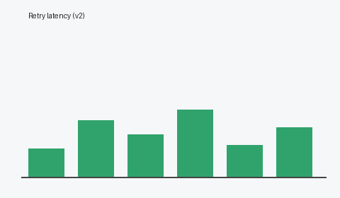

# Retry sandbox

Throwaway files for trying Pair Review on a real PR. Never merge this.

## What it does

The client retries failed requests with exponential backoff and jitter.
It gives up early on errors that won't go away, such as `401` or `404`.

| Setting | Value |
|---|---|
| Attempts | 5 |
| First delay | 100 ms |
| Max delay | 5 s |

## Try it

```ts
const user = await withRetry(() => fetchUser(id));
```



> See [the spec](docs/spec.pdf) and [the load test report](docs/report.pdf).
